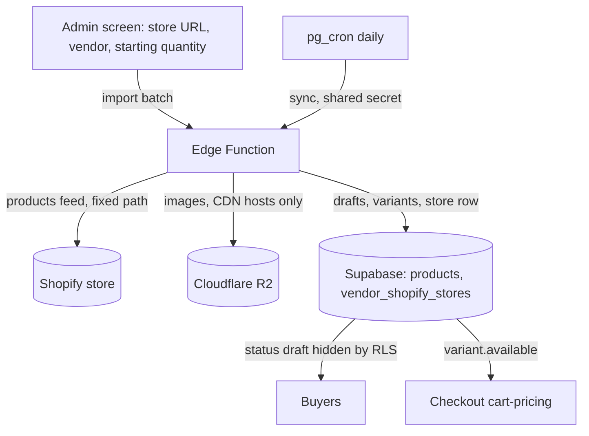

# Admin Shopify Catalogue Import - Plan

## Goal Capsule

- **Objective:** Onboarding a recruited vendor who already sells on Shopify takes a few minutes of admin review instead of hand-copying their catalogue onto lifestylemedicinegateway.com, and what LMG shows as in stock stays in line with the vendor's Shopify store.
- **Means:** A Supabase Edge Function that imports a store's catalogue as drafts and syncs stock daily (KTD1).
- **Product authority:** This plan covers the vendor-supply side only: the admin-run Shopify import and the daily stock sync that follows it. Buyer conversion, vendor self-serve import, vendor funnel reporting and vendor nudge emails are not active scope (see Scope Boundaries). The Product Contract wins on product behaviour; KTDs win on mechanism.
- **Open blockers:** None.

Product Contract preservation: changed. R4 now covers every image; R8 gains a no-overwrite qualifier; R11 to R16, A3, F2 and AE4 to AE6 are new, because the admin added image and stock-sync scope during planning. Other R/A/F/AE IDs are unchanged.

---

## Product Contract

### Summary

An admin enters a vendor's Shopify store URL and the system brings that store's products in as unpublished drafts under the vendor's LMG account, with every image copied into Cloudflare R2. The admin reviews and edits the drafts, then publishes them. A daily sync then keeps each imported variant's in-stock or out-of-stock state in line with the vendor's Shopify store.

### Problem Frame

LMG recruits vendors by hand. A recruited vendor registers without trouble, but the admin then migrates their products from the vendor's own website one at a time. This is the main time cost in onboarding, it grows with every vendor and every product, and it caps how fast the marketplace can add supply. The vendor dashboard's Products tab (`src/components/vendor/ProductsTab.tsx`) only adds products individually, and there is no bulk or Shopify import anywhere in the app. Most target vendors already run Shopify stores, so their catalogues already exist in structured form.

Vendors will keep selling on Shopify after they list on LMG. LMG already reduces its own stock on paid orders and restores it on a full refund before shipping, but it knows nothing about Shopify sales, so without a sync the two counts drift and LMG can sell something the vendor has sold out.

There is no data on the vendor funnel (applications, live listings, first sales), so the size of this bottleneck relative to other drop-offs is not measured.

### Actors

- A1. Admin: recruits the vendor, runs the import, reviews and publishes drafts, watches sync health.
- A2. Vendor: a registered LMG vendor with an existing Shopify store; owns the products once imported.
- A3. Scheduled sync: the daily job that refreshes stock state from each linked store.

### Key Decisions

- **Admin-run import, not vendor self-serve.** Removes the admin's onboarding workload now, while vendors are still recruited by hand and quality control matters. (session-settled: user-directed — chosen over vendor self-serve and admin-plus-vendor: the admin does the recruiting and wants control over what goes live.)
- **Vendor copy is imported unchanged.** Governs R10. The admin reviews it by eye rather than the AI copy tool rewriting it. (session-settled: user-directed — chosen over AI-adjusted drafts and a per-import toggle: the vendor's wording stays as written and the admin is the check.)
- **Shopify only.** Most target vendors run Shopify; other platforms are deferred. (session-settled: user-approved — chosen over a multi-platform import: one platform covers most vendors and keeps the first version small.)
- **Every image lives in R2.** Governs R4, R11. (session-settled: user-directed — chosen over keeping Shopify CDN links: images must not depend on the vendor's store.)
- **Automatic daily stock sync.** Governs R12 to R16. (session-settled: user-directed — chosen over import-once and import-plus-manual-re-sync: stock should follow Shopify without the admin remembering to run anything.)

### Requirements

**Import**
- R1. From admin, an admin can start an import by entering a vendor's Shopify store URL and choosing the existing LMG vendor the products belong to; the store link is saved against that vendor.
- R2. The import brings in each product's title, description, price, images and variants, to the extent the store exposes them.
- R3. Imported products arrive as unpublished drafts and are never visible to buyers until an admin publishes them.
- R4. Every image of an imported product, including variant images and images inside the description, is stored in Cloudflare R2; no imported product references the vendor's store for an image.
- R5. Imported products attach to the chosen vendor, so the vendor can see and edit them in their dashboard Products tab.

**Review and publish**
- R6. The admin can review and edit each imported draft using the same product editing the vendor dashboard already provides.
- R7. The admin can publish drafts individually or all at once.
- R11. A product with an image that could not be copied to R2 stays a draft and is flagged; it cannot be published, individually or in bulk, until a re-import copies the image.

**Safety**
- R8. Re-running the import for the same vendor and store does not create duplicate products or overwrite changes the admin or vendor has made to existing ones.
- R9. If the store URL is not a reachable Shopify store, or some products fail to import, the admin sees a clear result stating what was imported and what was not, and nothing is left half-published.
- R10. Product descriptions are imported exactly as the vendor wrote them, apart from unsafe HTML being removed, and the admin checks them against LMG's responsible-health-content rules (`CLAUDE.md`, "Responsible health content") before publishing.

**Stock**
- R12. Each imported variant starts in stock or out of stock as the store reports; in-stock variants get the store's quantity when the store exposes one, otherwise a starting quantity the admin sets on the import screen.
- R13. A daily sync sets each imported variant to in stock or out of stock to match its Shopify variant, and changes nothing else (price, copy, images, publish status, LMG's own stock count); a variant can be bought only when Shopify has it in stock and LMG's own count is above zero.
- R14. A product that no longer exists in the vendor's store has its variants marked out of stock; it is never deleted.
- R15. The sync runs for every vendor with a saved store link unless the admin has turned it off for that vendor, and admin shows each vendor's last sync time and result.
- R16. A sync that cannot read a store changes nothing for that vendor and shows as failed in admin.

### Key Flows

- F1. Onboard a Shopify vendor
  - **Trigger:** A recruited vendor has registered an LMG account and has an existing Shopify store.
  - **Actors:** A1, A2
  - **Steps:** Admin opens the import in admin, enters the store URL, selects the vendor and the starting quantity. The system imports products as drafts in batches, showing progress, and reports the result. Admin reviews and edits drafts, then publishes.
  - **Outcome:** The vendor's catalogue is live on LMG without the admin copying anything by hand.
  - **Covered by:** R1, R2, R3, R4, R5, R6, R7, R11, R12
- F2. Daily stock sync
  - **Trigger:** The daily schedule fires.
  - **Actors:** A3, A1
  - **Steps:** For each vendor with sync on, the job reads the store and updates variant stock state. It records the time and outcome per vendor. Admin sees the result and can switch a vendor's sync off.
  - **Outcome:** A Shopify sell-out or restock shows on LMG within a day.
  - **Covered by:** R13, R14, R15, R16

### Acceptance Examples

- AE1. **Covers R3, R7.** Given an import has just finished, when a buyer browses the marketplace, then none of the imported products appear; after the admin publishes them, they appear.
- AE2. **Covers R8.** Given a store was already imported for a vendor and the admin has edited a product's description, when the admin imports the same store again, then no product is duplicated and the edited description is unchanged.
- AE3. **Covers R9.** Given a store with some products the system cannot read, when the import runs, then the admin is told which products were skipped and the rest are saved as drafts.
- AE4. **Covers R4, R11.** Given a product whose second image cannot be fetched, when the import runs, then the product is saved as a flagged draft, publish-all skips it, and publishing it individually is refused; after the image becomes reachable and the admin re-imports, the product copies the image and can be published.
- AE5. **Covers R13, R14.** Given a variant sold out on Shopify, when the daily sync runs, then buyers can no longer add it to the cart; and given a product deleted from the store, its variants show out of stock and the product still exists.
- AE6. **Covers R16.** Given a vendor's store is down at sync time, when the sync runs, then that vendor's stock states are unchanged, admin shows the sync as failed with the time, and other vendors still sync.

### Success Criteria

- Onboarding a Shopify vendor drops from hand-copying the catalogue to a few minutes of review.
- A Shopify sell-out is reflected on LMG within one day without anyone running anything.
- No imported product shows an image served from the vendor's store.
- Planning can build this without deciding which products are imported, who owns them, when they go live, or what the sync may change.

### Scope Boundaries

**Deferred for later**
- Vendor self-serve import from the vendor dashboard.
- Imports from non-Shopify platforms or from CSV files.
- Syncing price, copy or image changes from Shopify; re-import never overwrites an existing product (R8).
- Automatically importing products the vendor adds to Shopify after the first import.
- A vendor funnel view (applied, live listing, first sale), since no funnel data exists today.
- Onboarding checklist and nudge emails for vendors who stall.
- First-sale support for new vendors, such as featuring them.

**Outside this plan**
- Buyer-side conversion work (a separate brainstorm).

**Considered and not built**
- Email or notification alerts for failed syncs: the admin screen shows failures, and a stale stock state fails safe by keeping the last known state. Evidence that would change this: failures going unnoticed for days.

### Dependencies / Assumptions

- Assumes no vendor funnel data exists; this was not measurable from the session or the repo.
- Assumes Shopify's public product feed gives in stock or out of stock per variant but not exact quantities. This is unverified; R12 covers both cases.
- Cloudflare R2 is the preferred media store (`.agents/AGENTS.md`); the Supabase Edge Function environment already holds the R2 credentials (`supabase/functions/get-r2-upload-url/index.ts`).
- The Vercel Hobby plan caps serverless functions per deployment (memory: `vercel-function-limit`), which is why the work runs in Supabase rather than as a new `api/*.ts` file.

### Outstanding Questions

**Deferred to Planning**
- Whether the store feed exposes quantities, and how Shopify variant fields map to LMG's variant shape.
- Whether `pg_cron` and `pg_net` are enabled on the Supabase project; if not, the schedule falls back to a Vercel cron entry on an existing router (see KTD5).
- How many products fit in one function call once images are copied, which sets the batch size.
- Which id format imported variants should use. Checkout reads `variant.id` both as a string key and, when numeric, as a stock id (`supabase/functions/_shared/cart-pricing.ts`), so confirm what `adjust_order_stock` expects before choosing between Shopify's numeric ids and generated ones (U2).

### Sources / Research

- `app/sell-with-us/page.tsx`: the vendor pitch page, a commission-only model.
- `app/vendor/page.tsx`, `src/components/vendor/ProductsTab.tsx`: vendor dashboard; no bulk or Shopify import (searched for csv, shopify, bulk, import). Products insert with `vendor_id` and a generated slug.
- `supabase/migrations/20261022_tighten_rls.sql`: drafts are hidden from buyers by RLS; admins keep full access to products.
- `supabase/functions/_shared/cart-pricing.ts`: checkout already treats `variant.available === false` as out of stock and reads `variant.stock`.
- `supabase/functions/stripe-webhook/index.ts`: stock is reduced on paid orders and restored on a full pre-shipment refund via `adjust_order_stock`.
- `supabase/functions/migrate-to-r2/index.ts`, `supabase/functions/get-r2-upload-url/index.ts`: server-side R2 write pattern and environment names.
- `docs/DEVELOPMENT_STANDARDS.md`: auth, SSRF allow-list, sanitising and test rules this work must follow.

---

## Planning Contract

### Key Technical Decisions

- KTD1. **One Edge Function, `import-shopify-catalogue`, with two operations: `import` and `sync`.** It runs in Supabase, which already holds the R2 credentials and sits outside the Vercel function cap. `import` is admin-only; `sync` accepts an admin session or a shared secret. Follows the layout of `supabase/functions/migrate-to-r2/index.ts` and `supabase/functions/notify-admin/index.ts`.
- KTD2. **All decision logic lives in `supabase/functions/_shared/shopify-import.ts` as pure functions.** URL checks, product mapping, image rewriting, description sanitising, slug creation and the stock merge are plain functions, so Vitest can test them the way it tests `_shared/cart-pricing.ts`. The function file only fetches, writes and wires them together.
- KTD3. **Source identity is stored on the product and the variant.** `products` gains a source platform and source reference with a unique index per vendor, which makes R8 a database guarantee rather than a check-then-insert race. Each imported variant keeps its Shopify variant id so the sync can match it. Governs R8, R13.
- KTD4. **The store link and sync state live in a new `vendor_shopify_stores` table, admin-only under RLS.** One row per vendor: store URL, sync on/off, last sync time, last result. Governs R1, R15, R16.
- KTD5. **The daily schedule is a `pg_cron` job that calls the function through `pg_net` with a shared secret.** The repo has no existing `pg_cron` use, so this is the one unverified prerequisite; the fallback is a Vercel cron entry on an existing router op, which costs no new function. Governs R15.
- KTD6. **Import runs in small batches driven by the admin screen.** Each call imports a few products and returns progress and a cursor; the screen loops until done. Image copying makes a whole catalogue too slow for one call, and KTD3 makes a repeated or resumed batch safe. Governs R9.
- KTD7. **Only fixed, validated addresses are fetched.** The store address is parsed with `new URL()`, must be `https`, must be a hostname (no IP addresses, `localhost` or internal suffixes), and only the store's product feed path is requested, without following redirects to other hosts. Images are fetched only from Shopify's CDN hostnames, only as `https`, with a size cap and an `image/*` content type check. Per `docs/DEVELOPMENT_STANDARDS.md` section 2. Governs R4, R9.
- KTD8. **A database trigger refuses publishing a flagged product.** Products carry an import issue note; a `BEFORE UPDATE` trigger rejects a change to `published` while it is set, so the rule holds for the edit form, publish-all and any future path. This is cheap now and hard to bolt on later. Governs R11.
- KTD9. **Descriptions are sanitised with the existing sanitiser, not rewritten.** `sanitizeHtml()` from `src/lib/security.ts` strips unsafe HTML; nothing else changes the vendor's wording. Image tags inside the description are rewritten to their R2 copies before sanitising. Governs R4, R10.
- KTD10. **Re-import skips products that already exist, except to finish flagged ones.** An existing product is never updated from Shopify content; a flagged product has its missing images retried and its flag cleared on success. Governs R8, R11.

### High-Level Technical Design

Directional guidance: the function is the only component that talks to Shopify or R2; the admin screen and the schedule only call it.

### Risks & Dependencies

- `pg_cron` or `pg_net` may not be enabled on the project (KTD5). Mitigation: fallback to a Vercel cron on an existing router op.
- An image that stays unreachable leaves a product permanently flagged (KTD8 has no manual override by design). The admin's way out is to fix or remove the image on the Shopify side and re-import, or delete the draft.
- Shopify may throttle or change its public feed. Mitigation: R16 keeps the last known state and shows the failure.
- The function and the migration are deployed by hand (memory: `deploy-workflow`): migration first in the SQL Editor, then CLI deploy from an up-to-date `main`.
- A new secret, `SHOPIFY_SYNC_SECRET`, must be set in the Supabase Edge Function secrets before deploy and recorded in `docs/DEVELOPMENT_STANDARDS.md` section 8.
- Dependency order: U1 before U3; U2 before U3 and U5 logic; U3 before U4 and U5.

---

## Implementation Units

### U1. Database: source identity, store links, publish guard

- **Goal:** Give products a stable Shopify identity, store the vendor's store link and sync state, and block publishing flagged products.
- **Requirements:** R1, R8, R11, R15, R16
- **Dependencies:** none
- **Files:** `supabase/migrations/20261101_shopify_import.sql` (create), `src/integrations/supabase/types.ts` (modify), `src/lib/__tests__/shopify-import-migration.test.ts` (create)
- **Approach:**
  1. Add source platform, source reference and import issue columns to `products`, with a unique index on vendor, platform and reference where the reference is set.
  2. Create `vendor_shopify_stores` with RLS enabled and admin-only policies using `public.is_admin()`; no `true` policies.
  3. Add the `BEFORE UPDATE` trigger from KTD8.
  4. Write it idempotently (`IF NOT EXISTS`, `DROP ... IF EXISTS`), per `docs/DEVELOPMENT_STANDARDS.md` section 3.
- **Patterns to follow:** `supabase/migrations/20261022_tighten_rls.sql`; `src/lib/__tests__/security-migration.test.ts` for reading migration text in a test.
- **Test scenarios:**
  - The migration enables RLS on `vendor_shopify_stores` and contains no `USING (true)` or `WITH CHECK (true)`.
  - The migration is idempotent in form: every create has `IF NOT EXISTS` or is preceded by a matching drop.
  - Covers AE4. The trigger text rejects a move to `published` when the import issue is set.
  - The unique index is partial on rows with a source reference, so hand-made products are unaffected.
- **Verification:** After the user runs it in the SQL Editor, `pg_policies` shows admin-only policies, and as an admin, a vendor and anon only admin can read `vendor_shopify_stores` (section 6.3).

### U2. Shared import logic

- **Goal:** All decisions of the import and sync as pure, tested functions.
- **Requirements:** R2, R4, R8, R9, R10, R12, R13, R14
- **Dependencies:** none
- **Files:** `supabase/functions/_shared/shopify-import.ts` (create), `src/lib/__tests__/shopify-import.test.ts` (create)
- **Approach:**
  1. Store address check returning a safe feed address or a clear reason (KTD7).
  2. Product mapping from a Shopify product to an LMG draft and variants, including title, price, source references, `available` per variant and starting stock (R12).
  3. Image handling: collect every image address (product, variant, inside description), check each against the CDN allow-list, and rewrite description image tags once copies exist.
  4. Description sanitising through `sanitizeHtml()` (KTD9); slug creation matching the vendor Products tab's pattern.
  5. Stock merge for the sync: given LMG variants and the Shopify feed, return updated `available` flags only, marking vendor-missing products out of stock (R13, R14).
- **Patterns to follow:** `supabase/functions/_shared/cart-pricing.ts` and its test `src/lib/__tests__/cart-pricing.test.ts`; `src/lib/security.ts`.
- **Test scenarios:**
  - Store address: `https://shop.example.com`, `shop.example.com` and a trailing-slash form all normalise to the same feed address.
  - Store address: `http://`, `https://127.0.0.1`, `https://localhost`, `https://10.0.0.5`, `https://[::1]`, a URL with credentials, and a URL with a non-feed path are all rejected with a reason.
  - Mapping: a product with two variants becomes one draft with two variants carrying distinct source references and the store's `available` values.
  - Mapping: a single "Default Title" variant maps to a product with no visible variant option, matching how checkout treats `Default Title`.
  - Covers AE3. A product missing a title or price is reported as skipped with its name and reason while others map.
  - Images: allow-listed CDN addresses pass; an image on any other host is flagged; a `data:` or `http:` address is flagged.
  - Images: description `` tags are rewritten to supplied R2 addresses, and an unrewritten tag blocks marking the product clean.
  - Sanitising: a description containing `<script>` and `onerror=` loses both but keeps the vendor's paragraphs and wording.
  - R12: with no quantity in the feed, in-stock variants get the admin's starting quantity and out-of-stock variants get zero.
  - Covers AE5. Sync merge turns a sold-out variant unavailable, restores a back-in-stock variant, leaves price, title and stock count untouched, and marks every variant of a product absent from the feed unavailable.
  - Sync merge: a variant with no source reference (hand-added) is never changed.
- **Verification:** The unit tests pass and the file imports nothing that Vitest cannot resolve.

### U3. Edge Function: import and sync operations

- **Goal:** The function that talks to Shopify and R2 and writes drafts and sync results.
- **Requirements:** R1 to R5, R8, R9, R11, R13 to R16
- **Dependencies:** U1, U2
- **Files:** `supabase/functions/import-shopify-catalogue/index.ts` (create), `supabase/config.toml` (modify), `src/lib/__tests__/edge-functions.test.ts` (existing, covers new function by directory scan)
- **Approach:**
  1. Header comment states the auth model first (section 2): `import` calls `requireAuth(req, ["admin"], ...)`; `sync` accepts an admin session or the shared secret via `requireWebhookSecret`, so `verify_jwt = false` goes in `supabase/config.toml`.
  2. `import`: validate the body (store address, vendor id as UUID, starting quantity as a bounded integer, cursor); on the first batch save or update the store link; fetch one page, process a few products, upload each product's images to R2 with the key layout used by `get-r2-upload-url`, insert drafts with source references, return counts, skipped items and the next cursor (KTD6, KTD10).
  3. A product whose image copy fails is inserted or kept as a draft with the import issue set; a retry that copies it clears the flag.
  4. `sync`: for each store with sync on, read its feed, apply the stock merge, write only changed rows, and record time and result on the store row; one store failing never stops the others (R16).
  5. Return generic errors to the client and log details server-side; never log tokens.
- **Patterns to follow:** `supabase/functions/migrate-to-r2/index.ts` (R2 client), `supabase/functions/_shared/auth.ts`, `supabase/functions/notify-admin/index.ts` (secret path).
- **Execution note:** Verify the four auth cases from `docs/DEVELOPMENT_STANDARDS.md` section 6.2 against a Supabase dev or branch project, not production data.
- **Test scenarios:**
  - The function uses `Deno.serve` and appears in `config.toml` with `verify_jwt = false` (enforced by `src/lib/__tests__/edge-functions.test.ts`).
  - No Authorization header returns 401; anon key only returns 401 or 403; a vendor or customer returns 403 on `import`; an admin gets 200 (manual, dev project).
  - Covers AE1. A freshly imported product has status `draft` and is absent from an anon query (manual, dev project).
  - Covers AE2. Importing the same store twice leaves the product count unchanged and an edited description intact (manual).
  - Covers AE4. A product whose second image 404s is a flagged draft; setting it to `published` is refused by the database (manual).
  - Covers AE6. Pointing a store row at an unreachable host marks that store failed and does not change its variants, while another store still syncs (manual).
- **Verification:** Imports a real small Shopify store end to end on a dev project and shows no Shopify CDN address in any imported row; this live step cannot be run from the repo and is reported as untested if skipped.

### U4. Daily schedule and deployment notes

- **Goal:** The sync runs every day without anyone starting it.
- **Requirements:** R13, R15
- **Dependencies:** U3
- **Files:** `supabase/migrations/20261101_shopify_sync_schedule.sql` (create), `docs/DEVELOPMENT_STANDARDS.md` (modify, section 8 table)
- **Approach:**
  1. Enable the needed extensions if missing and schedule one daily job at a quiet hour in Melbourne time that calls the function's `sync` operation with the shared secret, idempotently replacing any existing job of the same name.
  2. Record `SHOPIFY_SYNC_SECRET` in the section 8 table and state the run order: migration, set secret, merge, pull `main`, deploy the function.
  3. If the extensions are unavailable, replace this unit's mechanism with a Vercel cron entry on an existing router op and update KTD5 in place.
- **Patterns to follow:** the `/api/ads?op=sync` cron entry in `vercel.json` for the fallback shape.
- **Test expectation:** none -- scheduling SQL and documentation; verified live by checking the job exists and the next day's store rows show a fresh sync time.
- **Verification:** After deploy, the job is listed, and a manual trigger of `sync` updates the store rows' last sync time.

### U5. Admin screen: import, review, publish, sync health

- **Goal:** The admin can run the import, see what happened, publish safely and watch sync.
- **Requirements:** R1, R3, R6, R7, R9, R11, R12, R15, R16
- **Dependencies:** U3
- **Files:** `src/components/admin/AdminShopifyImport.tsx` (create), `app/admin/page.tsx` (modify, Product Catalog tab), `src/lib/__tests__/vendor-admin.test.ts` (existing, extend for admin-only wiring if suited)
- **Approach:**
  1. In the Product Catalog tab, add an "Import from Shopify" entry that opens the import screen: store URL, vendor picker (existing vendor list), starting quantity defaulting to 100.
  2. Drive the batches by repeatedly calling the function with the returned cursor, showing progress, and ending on a result report listing imported, skipped and flagged products with reasons (R9).
  3. Show imported drafts for the vendor with flagged ones marked, a "publish all" action that only affects unflagged drafts, and individual publish through the existing admin product editing (R6, R7, R11).
  4. Show each linked store with last sync time, result, and an on/off switch (R15, R16).
  5. Send the user's session on every call with the existing helpers; render vendor-supplied text as text, never raw HTML.
- **Patterns to follow:** `src/components/admin/AdminAdsTab.tsx` for an admin tab with server calls; `src/components/vendor/ProductsTab.tsx` for the product editing the admin reuses; `supabase.functions.invoke` as in `src/lib/upload.ts`.
- **Test scenarios:**
  - Covers F1. Golden path in `npm run dev`: import a small store, see progress, see drafts, publish one, and see it on the public product page (manual).
  - Failure path: enter a non-Shopify address and see a clear error with nothing imported (manual).
  - Covers AE4. A flagged draft shows its note, is skipped by publish all, and individual publish shows the database's refusal as a readable message (manual).
  - Covers F2. The sync panel shows last result and time, and switching a vendor off stops it appearing in the next sync (manual).
  - A non-admin visiting the admin route cannot reach the screen (existing admin guard; manual).
- **Verification:** `npm run verify` passes, the browser console is clean on the golden path, and no imported description renders unsanitised.

---

## Verification Contract

| Check | Command or step | Proves |
| --- | --- | --- |
| Types, tests, build, audit | `npm run verify` | All code units compile and unit tests pass |
| Shared logic | `npm run test` (file `src/lib/__tests__/shopify-import.test.ts`) | U2 behaviour, URL safety, sanitising, stock merge |
| Migration text | `npm run test` (file `src/lib/__tests__/shopify-import-migration.test.ts`) | RLS and trigger present, idempotent |
| Function conventions | `npm run test` (file `src/lib/__tests__/edge-functions.test.ts`) | `Deno.serve` and `verify_jwt` config |
| Auth cases | Four-case check from `docs/DEVELOPMENT_STANDARDS.md` section 6.2 on a dev project | U3 guards |
| RLS roles | Section 6.3 impersonation on `vendor_shopify_stores` and `products` drafts | U1 policies |
| Golden and failure path | `npm run dev`, then exercise U5 steps | End-to-end behaviour |

Not testable from the repo and to be stated as untested in the PR if skipped: live calls to Shopify and R2, the `pg_cron` schedule, and the migration against production.

## Definition of Done

- All units' verification passes and `npm run verify` is green.
- The `docs/DEVELOPMENT_STANDARDS.md` section 7 checklists for endpoint and table changes are walked through.
- Every acceptance example AE1 to AE6 has been exercised or explicitly listed as untested.
- The migration run order, secret and deploy order are written in the PR description.
- No imported row references a Shopify image address.
- Abandoned-attempt code and scratch files are removed from the diff.
